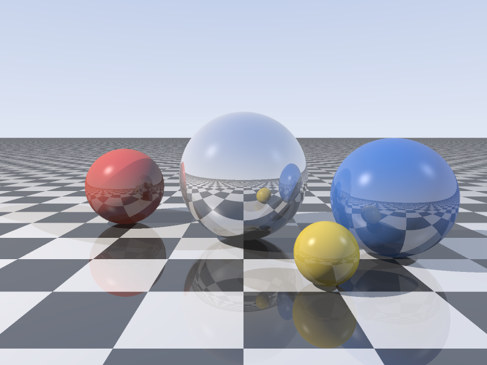

# NumPy ray tracer

[](https://github.com/bushesarebetter/raytracer/actions/workflows/tests.yml)

A small ray tracer in numpy. Every pixel's ray is traced at once as one big array, so a full 800x600 frame with reflections and 4 samples per pixel renders in about 7 seconds.

The scene has spheres on a checkered plane, Phong lighting from two point lights, hard shadows, mirror reflections up to a fixed depth, supersampled antialiasing and gamma correction.

[Preview](#preview) · [Setup](#setup) · [Run](#run) · [Tests](#test)

## Preview



## Setup

```bash
pip install -r requirements.txt
```

## Run

```bash
python raytracer.py
```

This writes `render.png`. Options: `--width`, `--height`, `--ss` (samples per pixel is ss*ss), `--depth` (reflection bounces), `--out`.

## Test

Install pytest in addition to the rendering dependencies:

```bash
pip install pytest
```

```bash
python -m pytest -q
```

The tests check ray-sphere distances against hand-worked cases, rays that should miss, ray-plane hits, and a tiny full render.
